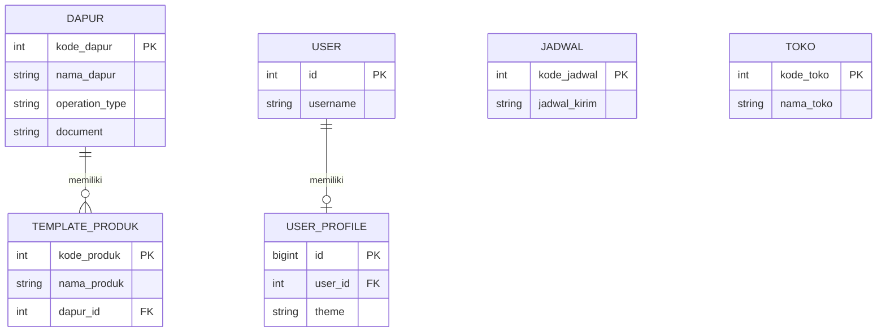

# Detailed Design Specification (DDS)
## Aplikasi Master Data (RO)

| Atribut | Nilai |
|---|---|
| Produk | Aplikasi Master Data |
| Repository | `xsigerproject-cyber/RO` |
| Branch acuan | `main` |
| Status dokumen | Desain teknis berdasarkan implementasi repository |
| Tanggal | 3 November 2026 |

## Dokumen Terkait

Alasan bisnis dan rekonstruksi keputusan percakapan dicatat pada [`doc/DECISION_LOG.md`](DECISION_LOG.md). Dokumen ini menjelaskan desain teknis; keputusan kebutuhan tetap merujuk pada PRD.

## 1. Tujuan Dokumen

DDS menjelaskan struktur teknis, komponen, model data, alur proses, endpoint, keamanan, dan deployment aplikasi berdasarkan source code repository. Detail yang belum diimplementasikan ditandai sebagai catatan, bukan diasumsikan tersedia.

## 2. Arsitektur Sistem

### 2.1 Komponen

| Komponen | Teknologi | Tanggung jawab |
|---|---|---|
| Browser | HTML, CSS, JavaScript, Bootstrap 5 | Antarmuka pengguna |
| Web application | Django 5.1+ | Routing, autentikasi, validasi, CRUD, impor/ekspor |
| WSGI server | Gunicorn | Menjalankan Django WSGI |
| Static middleware | WhiteNoise | Penyajian static files |
| Database | PostgreSQL 16 | Persistensi data |
| Container runtime | Docker Compose | Menjalankan service web dan database |
| Excel processing | openpyxl | Membaca dan membuat file XLSX |

### 2.2 Topologi Deployment

```text
Browser
   |
   | HTTP :7070
   v
Docker host
   |
   v
web container (Django + Gunicorn :8000)
   |             |
   |             +-- WhiteNoise / static files
   |
   | PostgreSQL connection (service db :5432)
   v
db container (PostgreSQL 16)
   |
   v
Docker volume: postgres_data
```

Docker Compose memetakan port host `7070` ke port container web `8000`. Database menggunakan named volume `postgres_data`.

### 2.3 Startup Container

Entrypoint web menjalankan urutan:
1. `python manage.py migrate --noinput`
2. `python manage.py collectstatic --noinput`
3. `gunicorn config.wsgi:application --bind 0.0.0.0:8000 --workers 3`

Service database memiliki healthcheck `pg_isready`; service web menunggu database sehat.

## 3. Struktur Source Code

| Path | Fungsi |
|---|---|
| `config/settings.py` | Konfigurasi Django, database, middleware, template, static files, timezone |
| `config/urls.py` | URL admin Django, login/logout, include URL masterdata |
| `masterdata/models.py` | Model Dapur, Jadwal, Toko, TemplateProduk, UserProfile |
| `masterdata/forms.py` | ModelForm dan Bootstrap widget styling |
| `masterdata/views.py` | Dashboard, daftar, CRUD, pencarian, Excel, theme |
| `masterdata/urls.py` | Routing fitur masterdata |
| `masterdata/permissions.py` | Fungsi pemeriksaan hak akses |
| `masterdata/context_processors.py` | Menyediakan tema aktif ke template |
| `masterdata/migrations/` | Skema database dan seed data |
| `templates/` | Template HTML Django |
| `static/` | CSS dan JavaScript aplikasi |
| `Dockerfile` | Image aplikasi |
| `docker-compose.yml` | Definisi service web dan db |
| `entrypoint.sh` | Startup migration, collectstatic, Gunicorn |

## 4. Desain Data

### 4.1 Entity Relationship



### 4.2 Definisi Tabel

#### Dapur
| Kolom | Tipe Django | Constraint |
|---|---|---|
| kode_dapur | PositiveIntegerField | Primary key |
| nama_dapur | CharField(120) | Wajib |
| operation_type | CharField(120) | Wajib |
| document | CharField(60) | Wajib |

#### Jadwal
| Kolom | Tipe Django | Constraint |
|---|---|---|
| kode_jadwal | PositiveIntegerField | Primary key |
| jadwal_kirim | CharField(120) | Wajib |

#### Toko
| Kolom | Tipe Django | Constraint |
|---|---|---|
| kode_toko | PositiveIntegerField | Primary key |
| nama_toko | CharField(120) | Wajib |

#### TemplateProduk
| Kolom | Tipe Django | Constraint |
|---|---|---|
| kode_produk | PositiveIntegerField | Primary key |
| nama_produk | CharField(160) | Wajib |
| dapur_id | ForeignKey ke Dapur | NOT NULL, ON DELETE PROTECT |

Relasi produk ke dapur menggunakan `related_name="produk"`. Primary key Dapur disimpan pada kolom relasi `dapur_id`; dalam file Excel kolom tersebut dipertukarkan menggunakan header `kode_dapur`.

#### UserProfile
| Kolom | Tipe Django | Constraint |
|---|---|---|
| id | BigAutoField | Primary key |
| user_id | OneToOneField ke User | Unique, ON DELETE CASCADE |
| theme | CharField(10) | Default `light`; choices light/dark/ocean/forest/sunset |

Signal `post_save` pada User membuat UserProfile saat user baru dibuat dan memastikan profile tersedia saat user disimpan kembali.

### 4.3 Urutan Data Master

- TemplateProduk bergantung pada Dapur.
- Dapur, Jadwal, dan Toko berdiri sendiri.
- Penghapusan Dapur yang masih direferensikan oleh TemplateProduk ditolak oleh constraint `PROTECT`.

## 5. Desain Data Awal (Seed)

Migration `0003_seed_master_data.py` bergantung pada migration `0002_userprofile` dan menggunakan historical models melalui `apps.get_model`.

Urutan proses:
1. Upsert enam record Dapur.
2. Upsert tiga record Jadwal.
3. Upsert enam record Toko.
4. Ambil Dapur berdasarkan kode 15 dan 14, lalu upsert enam record Template Produk dengan foreign key yang sesuai.

Operasi menggunakan database alias dari `schema_editor.connection.alias` dan `update_or_create` berdasarkan primary key.

Jumlah target setelah migration pada database baru:
- Dapur: 6
- Jadwal: 3
- Toko: 6
- Template Produk: 6

Reverse operation migration adalah `RunPython.noop`; rollback migration tidak menghapus data seed secara otomatis.

## 6. Routing dan Endpoint

Semua endpoint di bawah ini berada di root URL aplikasi kecuali prefix yang ditampilkan.

| Method | URL | Django route name | Fungsi |
|---|---|---|---|
| GET | `/` | dashboard | Dashboard |
| GET | `/dapur/`, `/jadwal/`, `/toko/`, `/produk/` | master_list | Daftar dan pencarian |
| GET/POST | `/<kind>/add/` | master_create | Form tambah |
| GET/POST | `/<kind>/<pk>/edit/` | master_edit | Form ubah |
| POST | `/<kind>/<pk>/delete/` | master_delete | Hapus |
| GET | `/<kind>/export/` | export_excel | Ekspor XLSX |
| GET | `/<kind>/import-template/` | download_import_template | Unduh template XLSX |
| POST | `/<kind>/import/` | import_excel | Impor XLSX |
| POST | `/theme/set/` | set_theme | Simpan tema |
| GET | `/accounts/login/` | login | Login Django |
| POST | `/accounts/logout/` | logout | Logout Django |
| Django admin | `/django-admin/` | admin | Administrasi Django |

Parameter `kind` yang didukung: `dapur`, `jadwal`, `toko`, dan `produk`. Nilai lain menghasilkan HTTP 404 melalui fungsi konfigurasi master.

## 7. Desain Proses Aplikasi

### 7.1 Autentikasi dan Otorisasi

- View utama menggunakan decorator `login_required`.
- Login menggunakan Django LoginView dengan template `registration/login.html`.
- Logout menggunakan Django LogoutView melalui POST form pada navbar.
- `can_manage(user)`: true untuk superuser atau anggota grup Admin Master/Editor Master.
- `can_delete(user)`: true untuk superuser atau anggota grup Admin Master.
- Pembuatan dan pengelolaan grup dilakukan melalui Django Admin sesuai konfigurasi yang tersedia.

### 7.2 Daftar dan Pencarian

1. View menerima `kind` dan memuat konfigurasi model, form, daftar field, dan judul.
2. Queryset awal mengambil seluruh objek model.
3. Jika parameter `q` terisi, view membangun kondisi pencarian.
4. Field teks memakai pencarian `icontains`.
5. Field integer dicari sebagai nilai eksak jika query berupa digit.
6. Pada produk, pencarian juga memeriksa `dapur__nama_dapur` dan `dapur__kode_dapur`.
7. Template daftar dirender dengan queryset, form tambah bila user berhak, dan flag izin.

### 7.3 Tambah dan Ubah

1. View memeriksa `can_manage`; jika tidak berhak, mengembalikan HTTP 403.
2. Untuk edit, objek diambil berdasarkan primary key.
3. Form ModelForm dibuat dari POST dan instance terkait.
4. Jika valid, form disimpan dan pengguna diarahkan ke daftar master.
5. Jika tidak valid, halaman form atau daftar dengan modal tambah ditampilkan kembali bersama error validasi.

### 7.4 Hapus

1. View memeriksa `can_delete`.
2. Hanya method POST diterima.
3. Objek dicari berdasarkan primary key.
4. Objek dihapus dan pengguna diarahkan kembali ke daftar.
5. Constraint relasi Dapur-Produk melindungi Dapur yang masih dipakai.

### 7.5 Impor XLSX

1. Periksa hak kelola.
2. Pastikan file tersedia, ukuran tidak lebih dari 5 MB, dan ekstensi `.xlsx`.
3. Buka workbook dengan openpyxl dalam mode read-only dan data-only.
4. Baca header dan pastikan semua kolom wajib tersedia.
5. Iterasi baris mulai baris kedua; lewati baris kosong.
6. Parse primary key menjadi integer.
7. Untuk produk, ubah input `kode_dapur` menjadi nilai foreign key `dapur`.
8. Trim nilai teks.
9. Cari instance berdasarkan primary key.
10. Validasi dengan ModelForm; simpan jika valid.
11. Semua baris diproses di dalam `transaction.atomic()`; error akan membatalkan transaksi.
12. Tampilkan pesan sukses atau error kepada pengguna.

Catatan: kode importer memetakan header ke dictionary berdasarkan nama kolom; header duplikat tidak secara eksplisit ditolak pada implementasi saat ini.

### 7.6 Template XLSX

1. Periksa hak kelola.
2. Buat workbook dan tulis header sesuai konfigurasi model.
3. Ambil record pertama dengan `order_by(model._meta.pk.name).first()`.
4. Jika record tersedia, tulis nilai field ke baris kedua.
5. Untuk relasi produk, tulis `sample_obj.dapur_id` pada kolom `kode_dapur`.
6. Jika tidak ada record, jangan tulis baris contoh.
7. Format header dan baris contoh; beri komentar pada sel contoh.
8. Bekukan baris header dan aktifkan autofilter.
9. Kembalikan file sebagai attachment XLSX.

Baris contoh adalah record yang benar-benar ada di database. Jika baris tersebut diimpor tanpa perubahan, importer akan menemukan primary key yang sama dan memperbarui record tersebut.

### 7.7 Ekspor XLSX

1. Ambil seluruh record pada model yang dipilih.
2. Tulis header dari konfigurasi field.
3. Iterasi objek dan tulis nilai setiap field.
4. Untuk field relasi produk, tulis `dapur_id` pada kolom `kode_dapur`.
5. Kembalikan workbook sebagai file XLSX.

### 7.8 Pengaturan Tema

1. Terima POST pada `/theme/set/`.
2. Baca nilai `theme`.
3. Validasi terhadap pilihan tema UserProfile.
4. Ambil atau buat profile pengguna.
5. Simpan tema dan kembalikan JSON status.

## 8. Validasi dan Penanganan Kesalahan

- Form CRUD menggunakan Django ModelForm.
- Field primary key impor harus integer positif sesuai model.
- Upload dibatasi 5 MB dan hanya ekstensi `.xlsx`.
- Header yang hilang menghasilkan pesan validasi.
- Foreign key produk harus menunjuk Dapur yang valid.
- Error validasi impor ditampilkan melalui Django messages.
- Error tak terduga dicatat melalui Python logger dan pesan umum ditampilkan.
- Akses tanpa hak menghasilkan HTTP 403; kind tidak dikenal menghasilkan HTTP 404; method yang tidak diizinkan pada delete menghasilkan HTTP 405.

## 9. Konfigurasi dan Environment

Environment variables yang dibaca:
- `SECRET_KEY`
- `DEBUG`
- `ALLOWED_HOSTS`
- `POSTGRES_DB`
- `POSTGRES_USER`
- `POSTGRES_PASSWORD`
- `POSTGRES_HOST`
- `POSTGRES_PORT`

Default database host pada settings adalah `localhost`, sedangkan deployment Compose harus menggunakan hostname service database `db` pada konfigurasi environment.

Pengaturan aplikasi:
- Bahasa: `id-id`
- Timezone: `Asia/Jakarta`
- Static URL: `/static/`
- Static root: `staticfiles/`
- Static source: `static/`

## 10. Keamanan

- Gunakan nilai `SECRET_KEY` yang kuat dan rahasia pada deployment.
- Jangan aktifkan `DEBUG` pada production.
- Atur `ALLOWED_HOSTS` sesuai hostname/IP server.
- Gunakan password PostgreSQL yang kuat dan jangan commit file `.env`.
- Operasi perubahan data dilindungi pemeriksaan hak akses server-side.
- Form POST Django menggunakan CSRF middleware; template form perlu menyertakan token CSRF.
- Gunakan HTTPS melalui reverse proxy jika aplikasi diakses melalui jaringan yang tidak tepercaya.

Catatan: konfigurasi HTTPS/reverse proxy, rate limiting, audit log, dan kebijakan backup tidak didefinisikan oleh file deployment yang ditinjau.

## 11. Operasional dan Deployment

Contoh alur instalasi/update pada server:

```bash
cp .env.example .env
# Isi SECRET_KEY, kredensial PostgreSQL, ALLOWED_HOSTS, dan POSTGRES_HOST=db
docker compose up -d --build
docker compose exec web python manage.py createsuperuser
```

Untuk update repository yang sudah terpasang:

```bash
git pull origin main
docker compose up -d --build
```

Entrypoint otomatis menjalankan migration dan collectstatic saat container web dimulai. Named volume database bernama `postgres_data`; perintah yang menghapus volume dapat menghilangkan data persisten dan tidak boleh digunakan sebagai langkah update rutin.

## 12. Verifikasi Teknis yang Disarankan

Sebelum rilis, jalankan dan verifikasi pada lingkungan target:
1. `python manage.py check`
2. `python manage.py showmigrations`
3. `python manage.py migrate --check` (jika tersedia pada versi Django yang digunakan)
4. Uji login, logout, dan setiap role.
5. Uji CRUD keempat master.
6. Uji proteksi penghapusan Dapur yang masih memiliki Produk.
7. Uji impor file valid, header salah, ukuran melebihi batas, ekstensi salah, primary key tidak valid, dan foreign key Dapur tidak ditemukan.
8. Uji rollback transaksi ketika salah satu baris impor tidak valid.
9. Uji ekspor dan template pada tabel berisi data maupun kosong.
10. Pastikan file CSS/JS static dapat diakses dari browser.

Dokumen ini adalah spesifikasi berdasarkan source code yang ditinjau; daftar verifikasi di atas bukan klaim bahwa seluruh pengujian telah dijalankan.


## 13. Status Template Produk dan Sinkronisasi Draft RO

### 13.1 Perubahan Model Data

Model `TemplateProduk` menambahkan field:
| Kolom | Tipe Django | Default | Keterangan |
|---|---|---|---|
| is_active | BooleanField | True | Menentukan apakah produk dapat digunakan pada RO baru dan Draft berjalan |

Migration `0005_templateproduk_is_active.py` menambahkan kolom tersebut. Record lama memperoleh nilai default `True`, sehingga produk yang sudah ada tetap tersedia setelah migration.

### 13.2 Form dan Daftar Master

- ModelForm Template Produk menampilkan field `is_active` sebagai checkbox Aktif.
- Daftar Template Produk menampilkan label Aktif atau Nonaktif.
- Field status turut disertakan dalam konfigurasi impor/ekspor Excel Template Produk.

### 13.3 Sinkronisasi Draft

Fungsi `_sync_draft_products` di `masterdata/ro_views.py` menerima kunci transaksi (Tanggal RO, Toko, Dapur, Jadwal) dan melakukan:
1. Mengambil produk Template Produk berstatus Aktif untuk Dapur tersebut.
2. Menghapus baris produk Nonaktif dari RO berstatus Draft pada kunci transaksi yang sama.
3. Mempertahankan baris produk yang masih Aktif, termasuk nilai Qty-nya.
4. Membuat baris RO baru dengan Qty 0 untuk produk Aktif yang belum ada pada Draft.
5. Tidak mengubah baris RO berstatus Terkirim.

Sinkronisasi dijalankan saat halaman transaksi Draft dibuka dan sebelum Draft disimpan/dikirim. Daftar produk diurutkan berdasarkan kode produk saat ditampilkan.

### 13.4 Batasan dan Verifikasi

- Produk Nonaktif yang sudah berada di RO Terkirim tetap tersimpan sebagai bagian dari riwayat transaksi.
- Mengaktifkan kembali produk menggunakan record Template Produk yang sama.
- Verifikasi yang perlu dilakukan pada lingkungan target: migration, form tambah/edit Template Produk, impor/ekspor status, sinkronisasi produk aktif/nonaktif pada Draft, dan kekekalan RO Terkirim.
- Pembaruan repository ini belum merupakan bukti bahwa migration atau pengujian telah dijalankan pada server produksi.


## 14. Desain Fitur Administrasi Data dan Inisialisasi (Rencana)

<badge>Desain; belum diimplementasikan</badge>

Bagian ini adalah rancangan fitur pembersihan data testing sebelum Go-Live, bukan deskripsi endpoint atau kode yang sudah tersedia.

### 14.1 Otorisasi

- Buat pemeriksaan izin khusus Administrator sesuai definisi peran RO pada PRD.
- Pemeriksaan dilakukan pada setiap view/action di server-side. Jangan menggunakan `can_delete` atau `can_manage` sebagai pengganti izin Administrator.
- Superuser boleh dianggap memiliki izin Administrator.
- Semua operasi mutasi menggunakan POST dan CSRF protection.
- Akses tanpa izin menghasilkan HTTP 403.

### 14.2 Penghapusan Template Produk

Sediakan tiga cakupan: satu produk, seluruh produk pada satu Dapur, dan seluruh Template Produk.

Untuk setiap cakupan:
1. Ambil target berdasarkan kode produk/Dapur atau seluruh queryset.
2. Hitung jumlah target dan jumlah target yang masih direferensikan oleh RO.
3. Tampilkan halaman konfirmasi berisi cakupan, jumlah target, dan informasi blokir referensi.
4. Jika ada referensi RO, tolak penghapusan tanpa mengubah data.
5. Jika tidak ada referensi, hapus target dalam `transaction.atomic()`.
6. Catat tindakan pada audit log yang dipertahankan.

Jangan memakai cascade yang menghapus RO secara implisit. Relasi `PROTECT` tetap menjadi pengaman integritas data.

### 14.3 Inisialisasi Data Testing

Urutan operasi dalam satu `transaction.atomic()`:
1. Validasi pemanggil adalah Administrator.
2. Validasi metode POST, CSRF, dan nilai konfirmasi persis `RESET DATA`.
3. Hitung jumlah baris RO dan Template Produk untuk ringkasan.
4. Hapus seluruh baris RO, termasuk Draft dan Terkirim.
5. Hapus seluruh Template Produk.
6. Simpan catatan audit berisi pelaku, timestamp, jenis tindakan, dan jumlah record yang dihapus.
7. Commit transaksi.

Jika penghapusan atau pencatatan audit gagal, rollback seluruh transaksi. Implementasi audit harus memastikan catatan inisialisasi tidak ikut terhapus; catatan dapat dibuat setelah penghapusan target dalam transaksi yang sama atau disimpan pada sistem log terpisah.

### 14.4 Data yang Dipertahankan

Inisialisasi hanya mengosongkan data RO dan Template Produk. Jangan menghapus/truncate Dapur, Jadwal, Toko, User, Group/Permission, UserProfile, konfigurasi aplikasi, migration history, maupun log audit yang harus dipertahankan. Jangan menjalankan `flush`, menghapus schema/database, menghapus volume Docker, atau mereset sequence secara otomatis.

### 14.5 Backup dan Pemulihan

- UI memberi peringatan untuk membuat backup PostgreSQL penuh sebelum tindakan.
- Backup harus dapat dipulihkan; membuat file backup saja bukan bukti pemulihan.
- Ekspor XLSX tidak mempertahankan seluruh relasi, akun, permission, dan konfigurasi sehingga bukan pengganti backup PostgreSQL.
- Prosedur restore dilakukan di luar fitur reset sesuai prosedur operasional database.

### 14.6 Rancangan UI

- Tambahkan menu khusus Administrator, misalnya **Administrasi Data**.
- Pisahkan area **Hapus Template Produk** dari **Inisialisasi Data Testing**.
- Setiap tindakan menampilkan jumlah data terdampak dan konfirmasi sebelum eksekusi.
- Inisialisasi menggunakan input konfirmasi teks `RESET DATA`.
- Setelah berhasil, tampilkan ringkasan jumlah RO dan Template Produk yang dihapus serta referensi log audit.

### 14.7 Pengujian Wajib Sebelum Rilis

- Uji akses Administrator, superuser, Admin Master, Editor Master, Viewer, Admin Toko, dan Admin Produksi sesuai role yang berlaku.
- Uji penghapusan produk tanpa RO dan produk yang masih direferensikan RO.
- Uji hapus per Dapur dan hapus seluruh Template Produk, termasuk kondisi referensi RO campuran.
- Uji reset ketika ada Draft saja, Terkirim saja, dan keduanya.
- Pastikan Dapur, Jadwal, Toko, user, grup, permission, UserProfile, migration history, dan audit log tetap ada.
- Simulasikan kegagalan setelah penghapusan RO untuk memastikan rollback mengembalikan RO dan Template Produk.
- Uji konfirmasi kosong/salah, request GET, CSRF gagal, dan akses langsung tanpa izin.
- Verifikasi backup dan prosedur restore secara terpisah.

Belum ada URL, nama view, model audit, atau migration yang ditetapkan. Detail implementasi ditentukan saat pekerjaan kode dimulai dan harus diselaraskan dengan source code/migration aktual.
